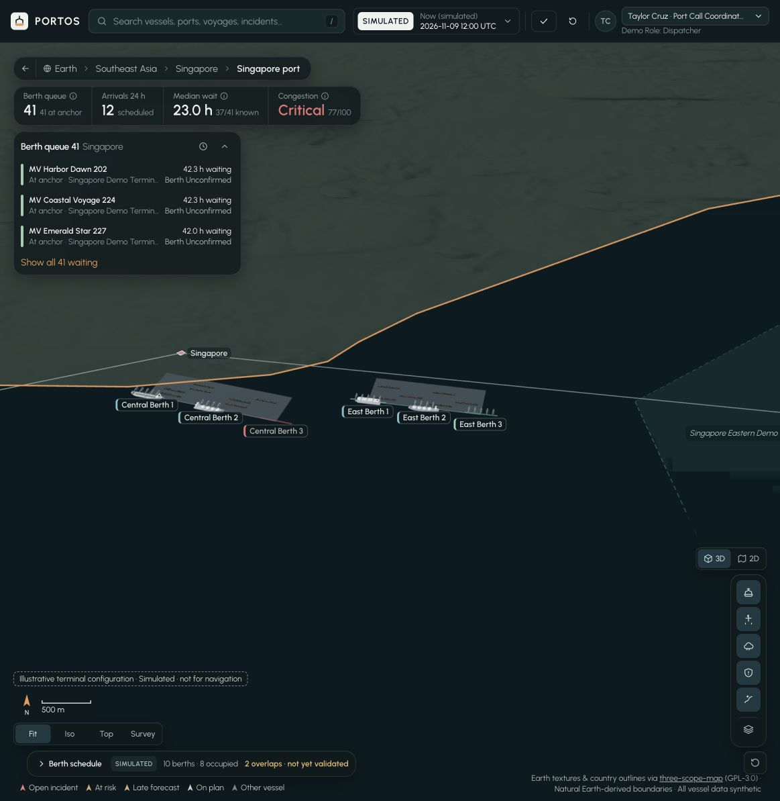
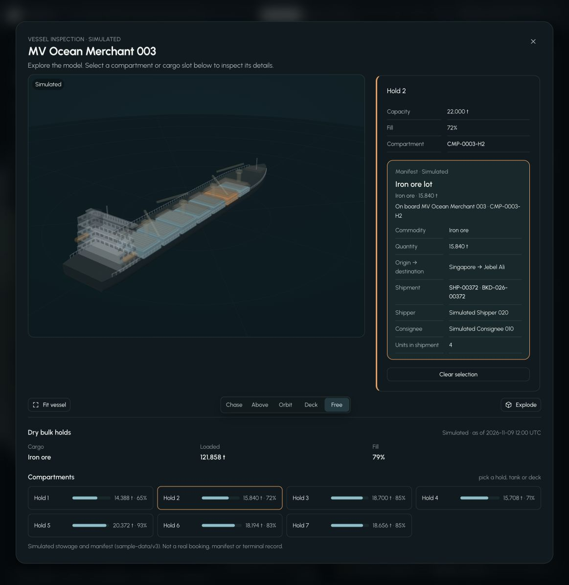

<div align="center">

# PORTOS
### Maritime operations, from globe to cargo hold.

A desktop maritime operations prototype for exploring fleet exceptions, port congestion, vessel cargo, and simulated decisions in one spatial workspace.

[**Open the demo ↗**](https://portos-os.vercel.app) · [Screenshot gallery](docs/SHOWCASE.md) · [Developer guide](docs/DEVELOPER_GUIDE.md) · [Deployment guide](docs/DEPLOYMENT.md)

**Vue 3 · TypeScript · Three.js · MapLibre · Pinia · Vite**

</div>

> **Desktop preview — mobile is not ready yet.** Use a desktop or laptop with a modern WebGL-capable browser. Small-screen layouts are experimental and are not a supported mobile experience.
>
> **All operational data is simulated.** PORTOS is a portfolio prototype, not live AIS, a navigation tool, or a production terminal system.


## Explore the product

| Experience | What you can do |
| --- | --- |
| Global fleet | Explore 500 synthetic vessels across 11 operational regions; inspect exceptions, routes, and weather overlays. |
| Geographic drilldown | Move from Earth into extruded regions, countries, cities, and illustrative port twins. |
| Port operations | Inspect berth queues, occupancy, schedules, terminal equipment, and simulated cargo transfer activity. |
| Vessel intelligence | Investigate voyage progress, forecast ETA shifts, modelled delay exposure, and supporting evidence. |
| Cargo inspection | Open a large 3D vessel viewer, orbit or explode the model, and select holds, tanks, decks, or container slots to read their manifests. |
| Case workflows | Investigate incidents, compare responses, and record decisions, tasks, and drafts locally in your browser. |
| Scenario replay | Follow vessels and replay a shared deterministic simulation clock at speeds up to 100×. |

### A closer look

<table>
<tr><td><br/><b>Regional operations</b></td><td><br/><b>Port twin</b></td></tr>
<tr><td><br/><b>Vessel intelligence</b></td><td><br/><b>Cargo inspection</b></td></tr>
</table>

See [the full screenshot gallery](docs/SHOWCASE.md) for routes, descriptions, and more states. These are captures of the working app, not design mockups.

## Try a short demo

1. Open [the globe](https://portos-shipar.vercel.app/ops/earth) and select Southeast Asia.
2. Visit [Singapore port](https://portos-shipar.vercel.app/ops/port/PRT-SIN) to explore the twin and berth queue.
3. Inspect [MV Pacific Horizon](https://portos-shipar.vercel.app/ops/earth?vessel=VSL-0001): its flagship scenario has an 18-hour forecast delay and $24,000 modelled exposure.
4. Open [MV Ocean Merchant 003](https://portos-shipar.vercel.app/ops/earth?vessel=VSL-0003&cargo=CMP-0003-H2), press **Expand**, then select a hold below the model. The annotation shows the selected compartment and simulated manifest.
5. Open [the incident](https://portos-shipar.vercel.app/ops/earth?incident=INC-0001), inspect its evidence, and compare possible responses.

## Run locally

Requires Node.js **20.19+ (20.x)** or **22.12+**, npm, and Python 3 for fixture validation.

```bash
git clone https://github.com/theShipar/portos.git
cd portos
npm ci
npm run dev
```

Open the local URL printed by Vite (normally `http://127.0.0.1:5173`). No API key is required. Optional map configuration is documented in `.env.example`.

```bash
npm run build            # TypeScript check + production build
npm run preview          # Serve the built app
npm test                 # Unit and component tests
npm run data:validate    # Fixture relationships and scenario integrity
npm run test:e2e         # Playwright journeys (requires browser installation)
```

## Architecture

The application runs in the browser. Vue owns the interface, Pinia owns shared state, and URL parameters preserve scope and selection. Pure simulation engines feed selectors used by both the interface and 3D scenes. Three.js renders the globe, spatial scenes, ships, and cargo workshop; MapLibre provides the optional 2D map.

```text
src/core/          Shared types and scenario clock
src/data/          Fixture loading and indexed catalogs
src/engines/       Pure simulation and operational calculations
src/selectors/     Consistent view models for UI and scenes
src/stores/        Shared state, session, selection, workflow
src/spatial/       Scene director, projections, port twins, cargo viewer
src/features/      Inspectors, cargo, incidents, comparison, replay
sample-data/       Generated synthetic datasets
public/geo/        Natural Earth-derived geometry
```

## Status and limitations

- **Mobile is not ready yet.** Desktop is the intended experience; touch interactions and small-screen workflows need further work.
- All vessels, manifests, incidents, financial estimates, and terminal operations are synthetic.
- Demo identity switching is not authentication. Workflow records are local to your browser and are not shared with other users.
- Port geometry and ship models are illustrative and are not suitable for navigation or operational planning.
- WebGL performance depends on the device. Public 2D basemap tiles require an internet connection.
- This is an evolving prototype; production authentication, persistence, live data ingestion, and monitoring are not implemented.

See [known limitations](docs/KNOWN_LIMITATIONS.md) and [release verification](docs/RELEASE.md). Historical QA reports describe their original builds and are not claims about the latest release.

## Documentation

- [Screenshot showcase](docs/SHOWCASE.md)
- [Developer guide and detailed walkthrough](docs/DEVELOPER_GUIDE.md)
- [Vercel deployment and release procedure](docs/DEPLOYMENT.md)
- [Architecture decisions](docs/DECISIONS.md)
- [Build log](docs/BUILD_LOG.md)
- [Known limitations](docs/KNOWN_LIMITATIONS.md)

## License and credits

**GPL-3.0-or-later.** The geographic renderer builds on techniques from [Three Scope Map](https://github.com/songsummer920-dazzle/three-scope-map-skill) by 宋夏天Dazzle. Derived source retains its notices; see [third-party attribution](third_party/three-scope-map/).

Geographic boundaries come from [Natural Earth](https://www.naturalearthdata.com/) (public domain). The optional 2D map uses OpenFreeMap, OpenMapTiles, and © OpenStreetMap contributors. Attribution remains visible in the application.
