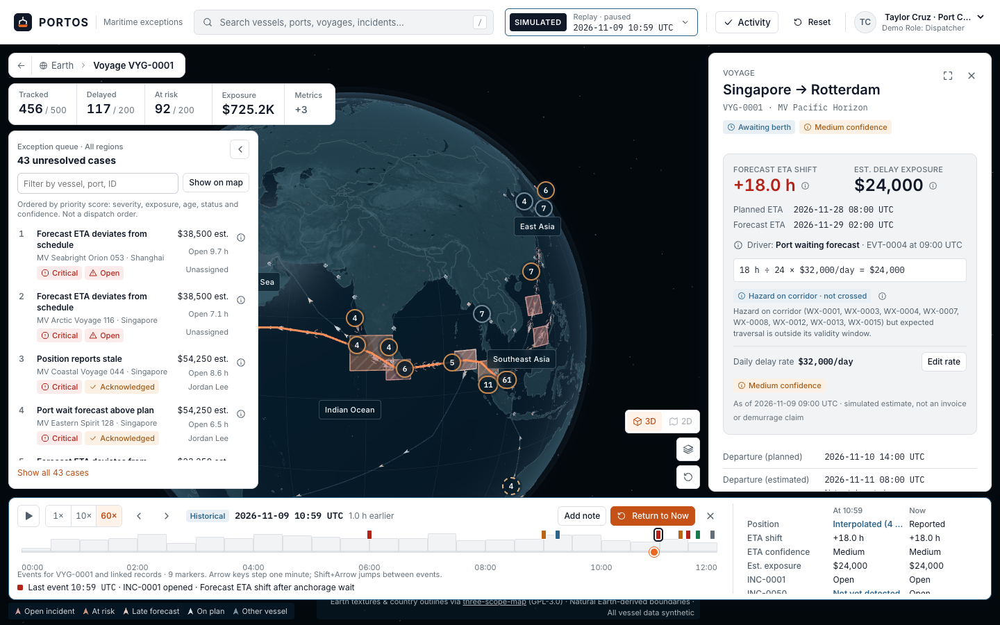

# PORTOS — maritime exception management prototype

PORTOS is a map-first operations prototype: a WebGL Earth that drills into maritime regions, a 2D Singapore port
view, and a case workflow for voyages at risk of delay. It runs entirely in the browser on **synthetic data**.

> **Not live AIS. Not navigation guidance.** Every vessel, position, port queue, weather hazard, incident and dollar
> figure is generated demo data on a simulated clock (2026-11-09, 00:00–12:00 UTC). Map lines and port zones are not
> nautical charts. Exposure figures are modelled estimates, not invoices or demurrage claims.



## Quick start

Requires Node `^20.19` or `>=22.12` and Python 3 (for the fixture validator).

```bash
npm ci
npm run dev            # http://127.0.0.1:5173
```

Then open `/operations`. The 2D port basemap loads tiles from OpenFreeMap (no key). Copy `.env.example` to `.env` to
point it at another MapLibre style or tile source.

## Commands

| Command | What it does |
|---|---|
| `npm run dev` | Vite dev server on 127.0.0.1:5173 |
| `npm run build` | Typecheck (`vue-tsc`) and production build into `dist/` |
| `npm run preview` | Serve `dist/` on 127.0.0.1:4173 |
| `npm run typecheck` | Strict TypeScript check of `src/` |
| `npm test` | Vitest unit tests (engines, fold, replay, workflow, contrast, resilience) |
| `npx playwright install chromium` | One-time browser download for E2E |
| `npm run test:e2e` | Playwright: builds `--mode e2e`, serves it, runs journey, resilience, gate and visual specs |
| `npx playwright test visual --update-snapshots=all` | Re-baseline the 16 visual snapshots in `tests/visual/` |
| `PERF=1 PERF_ANGLE=metal npx playwright test perf` | Performance probe → `docs/perf/*.json` (see `docs/PERF_REPORT.md`) |
| `npm run data:validate` | Validate `sample-data/` against the contracts and the Singapore scenario |
| `npm run data:generate` | Regenerate fixtures (deterministic) from `scripts/generate_demo_data.py` |

## Five-minute demo (Singapore exception)

1. **Global**: `/operations` shows the simulated fleet on Earth, compact KPIs and the exception queue.
2. **Region**: click *Southeast Asia*; the camera flies in and ports and corridors appear.
3. **Port**: click *Singapore*; switch to **2D** for the Eastern Demo Anchorage, terminals and the berth queue.
4. **Vessel**: pick *MV Pacific Horizon* (`VSL-0001`): forecast ETA **+18.0 h**, exposure **$24,000**
   (18 h × $32,000/day). The same numbers appear on the voyage, incident and KPI drill.
5. **Incident**: open `INC-0001` → Evidence shows the ETA revision, the port-wait update and the hazard check.
6. **Decision**: *Compare responses* lists three options with delay, exposure and confidence; propose one.
7. **Assign**: Actions → acknowledge, start investigating, assign Jordan Lee; the Activity hub shows the audit trail.
8. **Replay**: *Replay from detection*: scrub the rail and compare 10:59 UTC with Now; values match on every scrub.
9. **Back**: browser Back walks incident → port → region → Earth; every state is a URL you can share.
10. **Reset**: *Reset → Reset full demo* returns to identical starting numbers.

## How it is built

- **Vue 3 + TypeScript (strict) + Vite + Pinia + vue-router.** The URL is the source of truth for scope, selection,
  time (`?t=`), view mode and layers.
- **Globe**: Three.js scene adapted from the
  [Three Scope Map skill](https://github.com/songsummer920-dazzle/three-scope-map-skill) (GPL-3.0-or-later): Earth
  textures, batched outlines, a single render loop and GSAP camera flights. Vessels are instanced, screen-sized glyphs
  with LOD and clustering. See `docs/TECHNICAL_DEVIATIONS.md` for what differs from the skill.
- **Port 2D**: MapLibre GL JS 6 over OpenFreeMap tiles with a token-coloured style; the globe stays mounted with its
  loop stopped.
- **Engines** (`src/engines`): pure functions for ETA, congestion, exposure, weather risk, KPIs, provenance,
  priority and an event fold. `getSnapshotAt(catalog, t)` gives every screen the same numbers for any instant.
- **Workflow**: incident state machine, tasks, drafts, notes and an audit log persisted to `localStorage`, with
  role-based UI guards for the demo identities.
- **Design tokens**: `src/styles/tokens.json` (from the kit) → `tokens.css`, plus AA-contrast text variants (D-026).

```
src/
  core/        types, time, formatting, geo helpers
  data/        fixture loader and indexed catalog
  engines/     pure business logic (no Vue, no Three)
  selectors/   read models for the UI (no arithmetic in templates)
  stores/      Pinia: catalog, clock, view, snapshot, workflow, session, notices
  map/         Earth scene, maritime overlay, port 2D, layer menu
  features/    inspectors, incident, compare, port queue, replay, workflow
  components/  shell (header, KPI row, inspector drawer, breadcrumb) and UI primitives
sample-data/   generated fixtures (do not hand-edit)
tests/         unit (Vitest), e2e (Playwright), visual baselines
docs/          build log, decisions, deviations, QA, performance, limitations, screenshots
```

## Verification status

| Check | Result (2026-11-09) |
|---|---|
| `python3 scripts/validate_data.py` | pass (Singapore scenario verified) |
| `npm ci`, `npm run build`, `npm run typecheck` | pass |
| `npx vitest run` | 183 tests pass |
| `npx playwright test` | 43 tests pass (perf probe skipped unless `PERF=1`), incl. 16 visual baselines |
| Performance (Apple M4 Pro, Chromium/Metal) | ~60 fps p50 and p5 during flights and orbit; first interactive 0.6–2.0 s; flat GPU memory over 60 scope switches |

Details: `docs/BUILD_LOG.md`, `docs/VISUAL_QA.md`, `docs/PERF_REPORT.md`, `docs/KNOWN_LIMITATIONS.md`,
`docs/DECISIONS.md`.

## Prototype vs. production

| Area | This prototype | A production system would need |
|---|---|---|
| Vessel positions | Synthetic tracks, interpolated between reports | Licensed AIS/satellite feeds, deduplication, spoofing and gap detection, data-quality SLAs |
| Clock | Fixed 12-hour simulated window with replay | Real time, event streaming, late-arriving data, retention policies |
| ETA, congestion, exposure | Transparent deterministic formulas on fixture inputs | Validated models, calibration against outcomes, contractual rates, laytime/demurrage rules |
| Weather | 15 illustrative hazard polygons | Licensed forecasts, ensemble uncertainty, update cadence, and no routing advice without certification |
| Port layout | Invented Singapore terminals and anchorage | Port authority data, berth schedules, terminal operating system integration |
| Identity and permissions | Demo identity switcher; UI-only guards | Authentication (SSO), server-side authorisation, tenancy |
| Workflow storage | Browser `localStorage`, local audit log | Server persistence, concurrency control, immutable audit, notifications, integrations (email, TOS, ERP) |
| Drafts and proposals | Never sent; local only | Approval flows, delivery, templates, records retention |
| Maps | OpenFreeMap public tiles, no SLA | Hosted tiles with an SLA, offline packs, chart licensing where relevant |
| Quality | Chromium E2E, visual baselines, perf probe on one machine | Cross-browser matrix, load and soak tests, monitoring, accessibility audit with users |

## Licensing and attribution

PORTOS is released under **GPL-3.0-or-later** because the globe derives from the Three Scope Map skill by
宋夏天Dazzle (`third_party/three-scope-map/` holds its LICENSE, NOTICE and CITATION). Map data © OpenStreetMap
contributors (ODbL) via OpenFreeMap and OpenMapTiles; Natural Earth-derived boundaries. Attribution is shown on the
map in both views.
