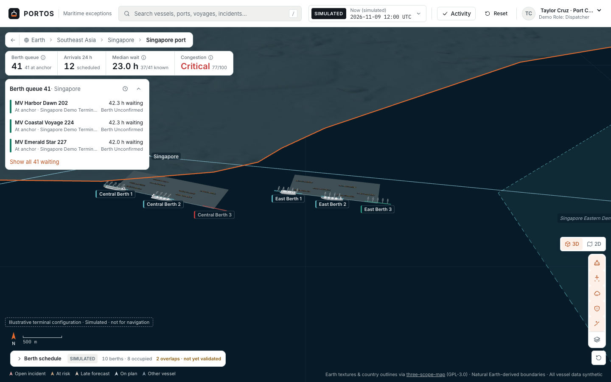

# PORTOS — maritime exception management prototype (V2)

PORTOS is a map-first operations prototype. A WebGL Earth hands off to extruded 3D geography (region, country,
city), then to a Singapore port twin with berths, cranes and anchorages. Recognisable 3D ships move on one scenario
clock from 1× to 100×, and a case workflow lets you investigate, compare responses and save decisions for
voyages at risk of delay. It runs entirely in the browser on **synthetic data**.

> **Simulated data only. Not live AIS. Not navigation guidance.** Every vessel, position, port queue, berth,
> weather hazard, incident and dollar figure is generated demo data on a simulated clock (2026-11-09, 00:00–12:00
> UTC, "Now" = 12:00 UTC). Extruded coastlines, port layouts and anchorages are illustrative, not nautical charts.
> Exposure figures are modelled estimates, not invoices or demurrage claims. Decisions are stored in your browser
> and never sent anywhere.



## Quick start

Requires Node `^20.19` or `>=22.12` and Python 3 (for the fixture tools).

```bash
npm ci
npm run dev            # http://127.0.0.1:5173 → /ops/earth
```

The 2D port basemap loads tiles from OpenFreeMap (no key). Copy `.env.example` to `.env` to point it at another
MapLibre style or tile source. The V2 spatial scenes can be switched off with `VITE_SPATIAL_V2=0` at build time or
`?spatialV2=0` in the first URL (V1 globe-only behaviour).

## Routes

| Route | View |
|---|---|
| `/ops/earth` | Global fleet on the Earth globe |
| `/ops/region/:regionId` | Extruded regional scene, e.g. `/ops/region/REG-SEA` |
| `/ops/country/:countryId` | Extruded country scene, e.g. `/ops/country/CNT-VNM` |
| `/ops/city/:cityId` | City / coastal scene, e.g. `/ops/city/CTY-SIN` |
| `/ops/port/:portId` | Port twin (Singapore, Rotterdam, Genoa) or 2D port map |

Query keys carry the rest of the state: `vessel`, `voyage`, `incident`, `route`, `hazard`, `panel=compare|replay`,
`time`, `view=3d|2d`, `layers` and `kpi`. All V1 URLs (`/operations`, `/region/…`, `/port/…`, `/vessel/…`,
`/voyage/…`, `/incidents/…`, `/corridors/…`, `/weather/…`, `/compare/…`, `/replay/…`) redirect to their `/ops`
equivalent.

## Commands

| Command | What it does |
|---|---|
| `npm run dev` | Vite dev server on 127.0.0.1:5173 |
| `npm run build` | Typecheck (`vue-tsc`) and production build into `dist/` |
| `npm run preview` | Serve `dist/` on 127.0.0.1:4173 |
| `npm run typecheck` | Strict TypeScript check of `src/` |
| `npm test` | Vitest unit tests (engines, clock, projections, ships, port twin, workflow, UI selectors) |
| `npx playwright install chromium` | One-time browser download for E2E |
| `npm run test:e2e` | Playwright: builds `--mode e2e`, serves it, runs the flagship journey, acceptance rows, handoff, ships, port twin, follow, routes, layout, resilience and visual specs |
| `PORTOS_EVIDENCE=1 npx playwright test flagship acceptance` | Re-record the browser evidence in `docs/qa/v2-phase9/` |
| `npx playwright test visual --update-snapshots=all` | Re-baseline the 16 visual snapshots in `tests/visual/` |
| `PERF=1 PERF_ANGLE=metal npx playwright test perf --project=chromium` | Performance probe → `docs/perf/*.json` (add `PERF_ROUND_TRIPS=30` for 60 scope switches) |
| `npm run data:generate` | Regenerate fixtures (deterministic) from `scripts/generate_demo_data.py` |
| `npm run data:validate` | Validate `sample-data/` against the contracts and the Singapore scenario |
| `python3 scripts/build_geo.py all` | Rebuild the Natural Earth scene geometry in `public/geo/` |

## Five-minute demo (the flagship journey)

1. **Earth**: `/ops/earth` shows the simulated fleet, the incident ribbon (top 3 cases) and the KPI rail.
2. **Region**: click *Southeast Asia*. The globe dives and hands off to an extruded 3D region. Drag to orbit, drag
   up to tilt, and scroll to zoom.
3. **City**: click *Singapore* for the city-state scene.
4. **Port**: click *Singapore port* for the twin: terminals, berths, cranes, anchorages and the berth queue.
   Click a berth to see its schedule; switch to **2D** at any time.
5. **Vessel**: search `VSL-0001` (*MV Pacific Horizon*), which is at anchor. The forecast ETA is **+18.0 h** and the
   exposure **$24,000** (18 h × $32,000/day). The berth estimate is *unconfirmed*.
6. **Incident**: *Investigate* opens `INC-0001` with its evidence and timestamps.
7. **Follow**: open `VSL-0047` (*MV Emerald Star 047*, underway Singapore → Manila) and press *Follow*. Set
   *Simulation ×1 / ×10 / ×100*: at 100×, one real second is 100 scenario seconds.
8. **Compare**: *Compare responses* shows the original plan and up to two options side by side, marked
   "Simulated outcomes, not confirmed."
9. **Decide**: propose an option. A local decision branch records the baseline and the simulated outcome.
10. **Replay**: `/replay/VYG-0001` puts the decision on the timeline as a bookmark. Step back to *INC-0001 opened*
    (10:59 UTC), expand the timeline and compare that moment with Now.

## How it is built

- **Vue 3 + TypeScript (strict) + Vite + Pinia + vue-router.** The URL is the source of truth for scene, selection,
  time, view mode and panel.
- **Spatial layer** (`src/spatial`):
  - `SpatialDirector` owns scene lifecycle, the one render loop and input.
  - `SceneCache` keeps warm scenes and disposes the rest.
  - `EarthGeographyBridge` runs the single-renderer handoff.
  - `Region3DScene` extrudes Natural Earth geometry through reversible projections; the port twin is a variant of it.
- **Globe**: a Three.js scene adapted from the
  [Three Scope Map skill](https://github.com/songsummer920-dazzle/three-scope-map-skill) (GPL-3.0-or-later): Earth
  textures, batched outlines and GSAP camera flights.
- **Ships** (`src/map/vessels3d`): a procedural 3D library with six categories at LOD0–2, a heading contract,
  wakes only when underway, and instanced batches.
- **Clock and engines**:
  - `src/core/scenarioClock.ts` and `src/engines/world.ts` give every screen the same deterministic frame for any
    time and rate.
  - Engines (`src/engines`) are pure: ETA, ETA variance, congestion, exposure, JIT, service chain, route
    feasibility, berth timeline, KPIs and the event fold.
- **Workflow**: the V2 case lifecycle (untriaged → investigating → option proposed → approved for simulation →
  monitoring → resolved → closed), decision branches, tasks, drafts and an audit log, all in `localStorage`.
- **Port 2D**: MapLibre GL JS over OpenFreeMap tiles.
- **Design tokens**: `src/styles/tokens.v2.json` → `tokens.css` / `tokens.ts`. The kit's `tokens.json` is kept for
  provenance.

```
src/
  core/        types, time, scenario clock, case stages, layers, follow rules
  data/        fixture loader and indexed catalog (base + sample-data/v2)
  engines/     pure business logic (no Vue, no Three)
  selectors/   read models for the UI (no arithmetic in templates or scenes)
  spatial/     director, scene cache, input router, projections, handoff bridge, extruded and port-twin scenes
  stores/      Pinia: catalog, clock, view, snapshot, workflow, session, notices
  map/         Earth view, maritime overlay, 3D ship library, port 2D, layer palette, entity peek
  features/    inspectors, incident, compare, port, replay timeline, follow, workflow
  components/  shell (header, KPI rail, inspector drawer, breadcrumb) and UI primitives
public/geo/    Natural Earth scene geometry (+ PROVENANCE.md)
sample-data/   generated fixtures (do not hand-edit)
tests/         unit (Vitest), e2e (Playwright), visual baselines
docs/          build log, decisions, deviations, QA evidence, changelog, performance, screenshots
```

## Verification status

| Check | Result (2026-11-11) |
|---|---|
| `python3 scripts/validate_data.py` | pass (Singapore scenario and V2 module verified) |
| `npx vue-tsc --noEmit`, `npm run build` | pass |
| `npx vitest run` | 329 tests pass |
| `npx playwright test` | 84 pass, 6 skipped (opt-in perf and capture), including the flagship journey, the spec 19 acceptance rows and 16 visual baselines |
| Spec 19 matrix M01–M20 | all PASS in automated browser runs; see `docs/PORTOS_V2_QA_EVIDENCE.md` for evidence and what was not run |
| Performance (Apple M4 Pro, Chromium/Metal) | 59.9 fps p50 during flights and orbit; first interactive 0.64 s; flat GPU memory over 60 scope switches (`docs/PERF_REPORT.md`) |

Details: `docs/PORTOS_V2_CHANGELOG.md`, `docs/PORTOS_V2_QA_EVIDENCE.md`, `docs/BUILD_LOG.md`, `docs/PERF_REPORT.md`,
`docs/KNOWN_LIMITATIONS.md`, `docs/DECISIONS.md`, `docs/TECHNICAL_DEVIATIONS.md`.

## Prototype vs. production

| Area | This prototype | A production system would need |
|---|---|---|
| Vessel positions | Synthetic tracks, interpolated between reports; reporting gaps shown as unverified | Licensed AIS/satellite feeds, deduplication, spoofing and gap detection, data-quality SLAs |
| Clock | Fixed 12-hour simulated window, 1–100× playback and replay | Real time, event streaming, late-arriving data, retention policies |
| ETA, congestion, exposure | Transparent deterministic formulas on fixture inputs | Validated models, calibration against outcomes, contractual rates, laytime/demurrage rules |
| Weather | 15 illustrative hazard polygons | Licensed forecasts, ensemble uncertainty, update cadence, and no routing advice without certification |
| Geography and port layout | Natural Earth coastlines; invented terminals, berths and anchorages | Port authority data, surveyed quay geometry, berth schedules, terminal operating system integration |
| 3D ships | Procedural models by vessel category | Licensed or measured models per class where fidelity matters |
| Identity and permissions | Demo identity switcher; UI-only guards | Authentication (SSO), server-side authorisation, tenancy |
| Workflow storage | Browser `localStorage`, local audit log, local decision branches | Server persistence, concurrency control, immutable audit, notifications, integrations (email, TOS, ERP) |
| Maps | OpenFreeMap public tiles, no SLA | Hosted tiles with an SLA, offline packs, chart licensing where relevant |
| Quality | Chromium E2E, visual baselines, perf probe on one machine | Cross-browser matrix, load and soak tests, monitoring, accessibility audit with users |

## Licensing and attribution

PORTOS is released under **GPL-3.0-or-later** because the globe and the extruded-scene code derive from the Three
Scope Map skill by 宋夏天Dazzle. `third_party/three-scope-map/` holds its LICENSE, NOTICE and CITATION, and the
derived source files keep their GPL notices. Boundaries and coastlines come from Natural Earth (public domain; see
`public/geo/PROVENANCE.md`). The 2D map data is © OpenStreetMap contributors (ODbL), via OpenFreeMap and
OpenMapTiles. Attribution is shown on the map in every view.
