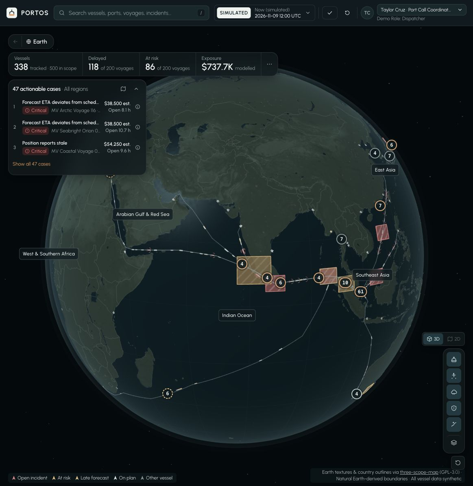
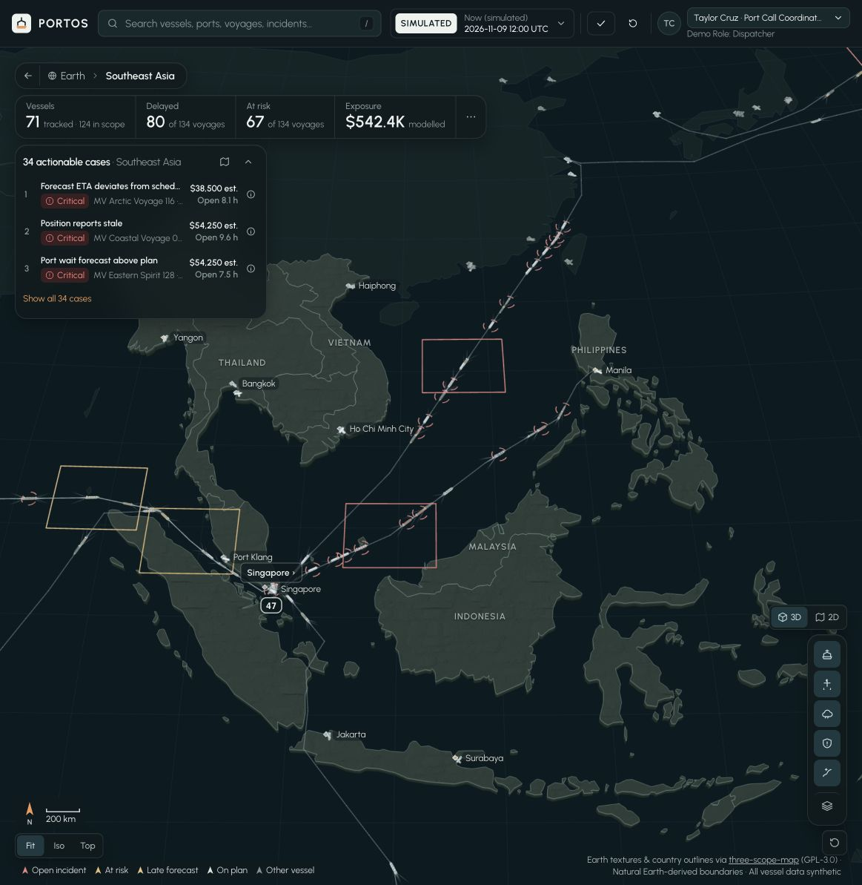
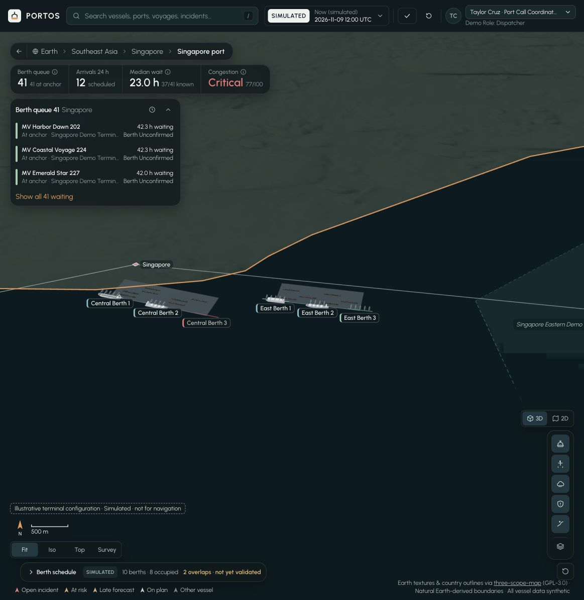
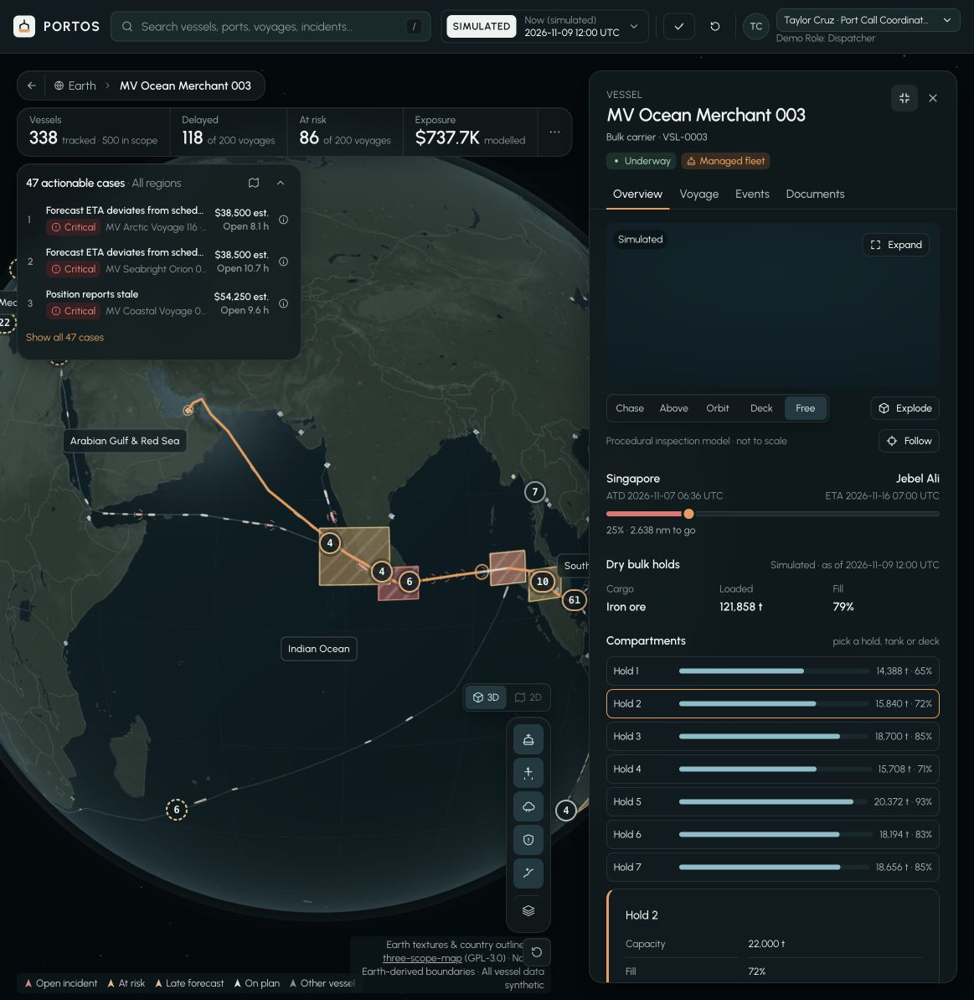
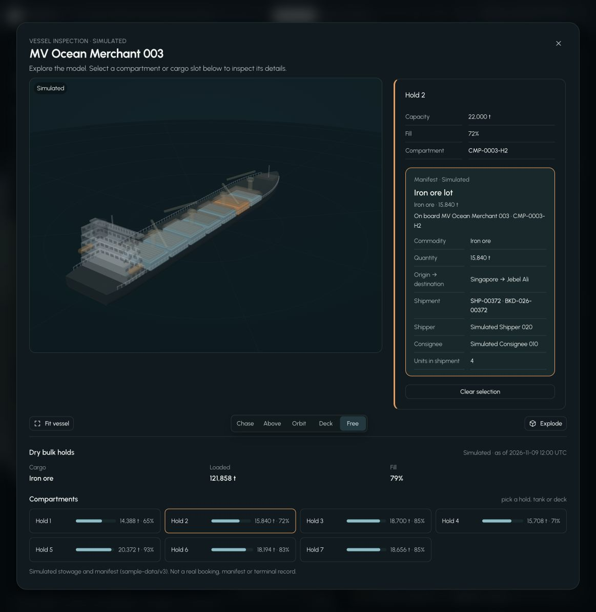
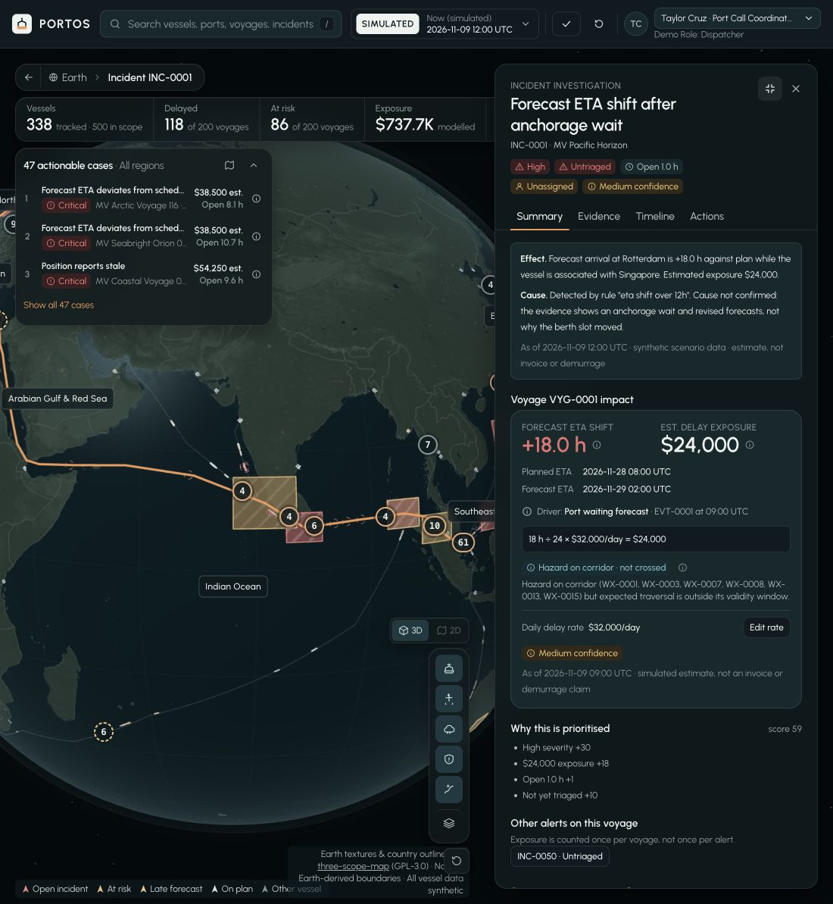
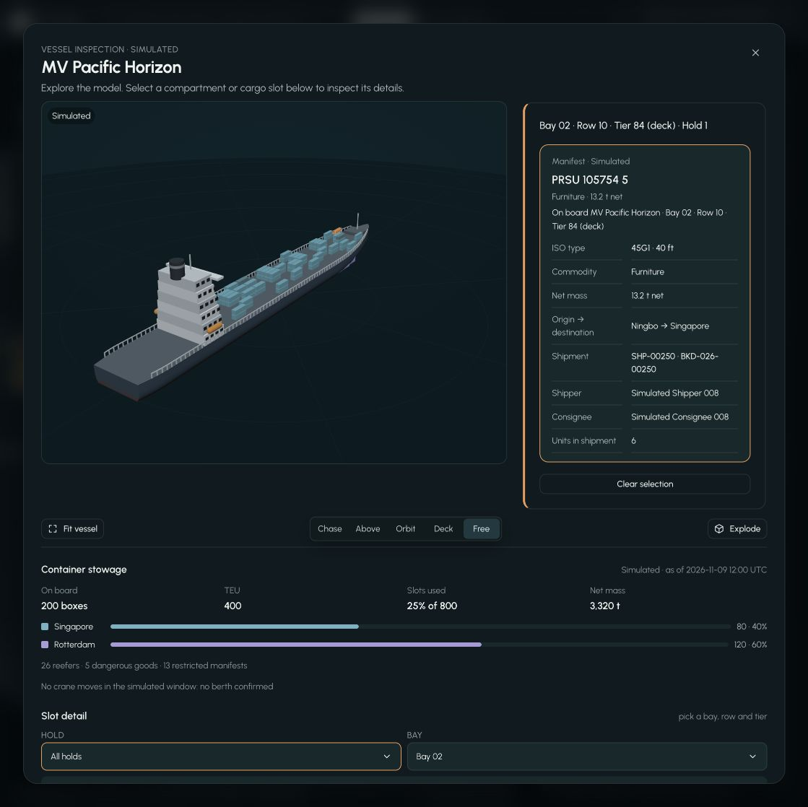

# PORTOS — product showcase

[Open the desktop demo](https://portos-shipar.vercel.app) · [Back to README](../README.md)

**Mobile is not ready yet.** These screenshots show the desktop prototype, captured from the running application on 17 November 2026. All operational data is simulated. Values reflect the selected scenario time, not current maritime conditions.

## Global fleet

The globe combines fleet distribution, weather overlays, operational routes, scope KPIs, and a prioritized exception queue.

[Explore this state](https://portos-shipar.vercel.app/ops/earth)

## Regional operations

Extruded geography provides regional context while keeping ports, ships, route corridors, and actionable cases visible together.

[Explore Southeast Asia](https://portos-shipar.vercel.app/ops/region/REG-SEA)

## Singapore port twin

An illustrative port twin connects the berth queue with terminals, berths, anchorages, occupancy, and a collapsible berth schedule.

[Explore Singapore port](https://portos-shipar.vercel.app/ops/port/PRT-SIN)

## Vessel inspector

The inspector places the selected vessel's preview, voyage progress, cargo, and operational context beside the map. The expand control increases the desktop sidebar to 40% of the viewport.

[Inspect the bulk carrier](https://portos-shipar.vercel.app/ops/earth?vessel=VSL-0003&cargo=CMP-0003-H2)

## Expanded cargo inspection

Press **Expand** on the preview to open a focused modal with a blurred backdrop. Select a compartment below the model to view its capacity, fill, quantity, route, and simulated manifest. Camera presets, free orbit, Fit vessel, and exploded view support inspection.

## Incident investigation

Cases connect the operational problem with evidence, forecast impact, and local workflow actions. Demo actions do not send messages or change real vessel operations.

[Inspect the flagship incident](https://portos-shipar.vercel.app/ops/earth?incident=INC-0001)

## Container stowage

Container vessels expose hold and bay selectors, a keyboard-accessible bay section, and slot-linked manifests. Restricted cargo fields remain restricted in the demo view.

[Inspect container stowage](https://portos-shipar.vercel.app/ops/earth?vessel=VSL-0001)

